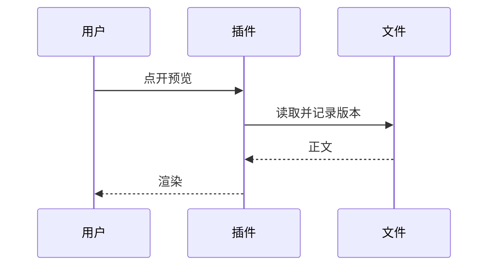

# 可交互 Markdown 验收样例

这一份文档是固定样例。每个章节对应一个组件，正常、边界、失败三类样例都在，改样式或加组件后按章节逐项点一遍。

## 标题层级

# 一级标题
## 二级标题
### 三级标题
#### 四级标题
##### 五级标题
###### 六级标题

## 行内元素

普通段落里可以有 **粗体**、*斜体*、~~删除线~~、`行内代码` 与[普通链接](https://example.com)。

链接路由样例：[文件链接](README.md) 指向同目录的说明文件，[图片链接](assets/checker.png) 指向图片文件。两者都在右侧栏打开预览，不打开灯箱，也不离开应用。

换行测试：这一行末尾是两个空格  
所以这一行应该出现在下一行，而不是同一段落里的软换行。

中文标点测试：他说「先读正文，再看图与代码。」之后停顿了一下……然后继续。括号（全角）与英文括号 (half width) 混排。

行内代码里出现反引号的情况用双反引号包裹：`` `code` ``。

## 列表

无序列表：

- 第一项
- 第二项
  - 嵌套一项
  - 嵌套二项
- 第三项

有序列表，从三开始：

3. 第三
4. 第四
5. 第五

任务列表：

- [x] 已完成的项
- [ ] 未完成的项

## 引用

> 普通引用的一段话。
> 第二行仍在同一个引用里。

列表里的引用保持普通引用，不会变成 Callout：

- 列表项
  > 引用在列表项里
  > 这里写 `[!note]` 也不该变成 Callout

## Callout

七族、13 个规范类型，加上大小写与别名。

> [!note] 说明族
> 正文可以有 **粗体**、`行内代码` 与[链接](https://example.com)。

> [!abstract] 摘要族
> 没有独立 token，用 info 与 success 混出的青色。

> [!info] 信息族
> 信息族与 note 同族，颜色相同，靠类型名区分。

> [!todo] 待办族
> 待办也归在 info 族。

> [!tip] 建议族
> 建议归在 success 族。

> [!success] 成功族
> 成功用 success token。

> [!question] 问题族
> 问题归在 warning 族。

> [!warning] 注意族
> 注意用 warn token。

> [!failure] 失败族
> 失败归在 danger 族。

> [!danger] 危险族
> 危险用 error token。

> [!bug] 缺陷族
> 缺陷也归在 danger 族。

> [!example] 示例族
> 示例如用 done token。

> [!quote] 引用族
> 引用族走中性色。

空标题的 Callout：

> [!note]
> 只有正文，没有标题。

带多个块的 Callout：

> [!tip] 里层结构
> 第一段。
>
> - 列表也能放进来
> - 第二项
>
> ```ts
> const inside = true
> ```

大小写与别名：

> [!WARNING] 大写类型
> 标题也照常显示。

> [!summary] 用别名
> summary 解析成 abstract。

未知类型与折叠语法保持普通引用：

> [!unknown] 未知类型
> 这一块应该显示成普通引用。

> [!note]- 折叠语法
> 这一块也应该显示成普通引用。

## 代码块

带语言标签与超长行，用来试「换行 / 不换行」：

```ts
const shortLine = 1
const veryLongLine = 'aaaaaaaaaaaaaaaaaaaaaaaaaaaaaaaaaaaaaaaaaaaaaaaaaaaaaaaaaaaaaaaaaaaaaaaaaaaaaaaaaaaaaaaaaaaaaaaaaaaaaaaaaaaaaaaaaaaaaaaaaaaaaaaaaaaaaaaaaaaaaaaaaaaaaaaaaaaaaaaaaaaa'
function demo(input: string): string {
  return input.repeat(2)
}
```

无语言标签：

```
plain text fence
second line

after a blank line
```

空代码块：

```
```

## 表格

窄表：

| 列一 | 列二 | 列三 |
|---|---|---|
| 值 | 另一个值 | 第三个值（更新） |

对齐：

| 左对齐 | 居中 | 右对齐 |
|:--|:--:|--:|
| 左 | 中 | 右 |
| 短 | 中间 | 99998 |

超宽表：窄栏横滚；全屏默认也横滚，点弹框头部多出来的「换行」改成折行，列数不再受限：

| 组件 | 输入 | 输出 | 触发 | 回退 | 主题 | 体积 | 备注 | 状态 | 责任 | 版本 | 验收 |
|---|---|---|---|---|---|---|---|---|---|---|---|
| Callout | 标记行 | 提示块 | 顶层引用 | 普通引用 | token | 0 | 13 类型 | 已完成 | 渲染 | 0.0.1 | 是 |
| Mermaid | 图围栏 | SVG | 出现图 | 源码 | palette | 3.2MB | 懒加载 | 已完成 | chunk | 0.0.1 | 是 |
| Markmap | 导图围栏 | 导图 | 出现导图 | 源码 | palette | 116KB | 懒加载 | 已完成 | chunk | 0.0.1 | 是 |
| Math | 公式 | 公式 | 出现公式 | 源码 | — | 待定 | P4e | 未完成 | chunk | 0.0.1 | 否 |
| Image | 图片 | 图片 | 进入视口 | alt | — | 0 | 点击放大 | 已完成 | 渲染 | 0.0.1 | 是 |
| Table | GFM | 表格 | 标准语法 | 原文 | token | 0 | 横滚 | 已完成 | 渲染 | 0.0.1 | 是 |

带长路径的单元格，用来确认换行与滚动的边界：

| 文件 | 说明 |
|---|---|
| `packages/active-markdown/client/src/rich/mermaid/chunk.tsx` | 路径比较长，应该换行而不是撑破 |
| `design/assets/checker.png` | 短路径 |
| `packages/active-markdown/client/src/body.tsx` | 这一行用来看全屏里的折行：默认横滚，点头部「换行」之后应当按面板宽度折行，不再需要左右拖。 |

## 图片


同一张图重复引用，确认懒加载与放大都能用：


## Mermaid

正常流程图：


顺序图：



写坏的图，应该回退成源码加错误首行：

```mermaid
flowchart LR
  broken -->-->
```

## 思维导图

```markmap
# 可交互 Markdown
## 翻译
- 整篇翻译
- 行号对齐
- 保存到工作区
## 批注
- 文本选区
- 组件整块
- 加入对话
## 编辑
- 源码编辑
- 版本守卫
- 冲突三出口
## 富渲染
- Callout
- Mermaid
- 数学
```

## 分隔线

上面一段。

---

下面一段。

## 排版

一篇长段落，用来看阅读宽度、行高与中文标点。阅读工具的价值不在功能列表，而在读者愿意停留多久。段落太宽会让人找不到下一行的开头，段落太窄又会让人频繁换行。四十四字符左右的正文宽度是常见折中，也是本插件的默认值，窄栏里它不起作用，全屏里它把正文收在中间。中文标点需要一点额外处理，句号与逗号之间的空隙、引号与括号的挤压，都会影响阅读节奏。插件只做纯 CSS 的压缩，不改写文本。

第二段用来确认段间距与标题前的留白。**粗体**、*斜体*、`inline code` 与[链接](https://example.com)在长段落里的观感，和短段落应该一致。行高沿用宿主的内容字号与 1.7 倍行高，不在插件里另立一套。

## 数学

行内公式样例：质能方程 $E = mc^2$，欧拉恒等式 $e^{i\pi} + 1 = 0$。同一行可以放多个公式，`$ x $` 这种带空格的写法保持原文。

行间公式样例：

$$
\int_0^1 x^2 \, dx = \frac{1}{3}
$$

公式围栏样例：

```math
\sum_{n=1}^{\infty} \frac{1}{n^2} = \frac{\pi^2}{6}
```

写坏的公式回退成源码，并可以复制错误：

$$
\notacommand{x}
$$
