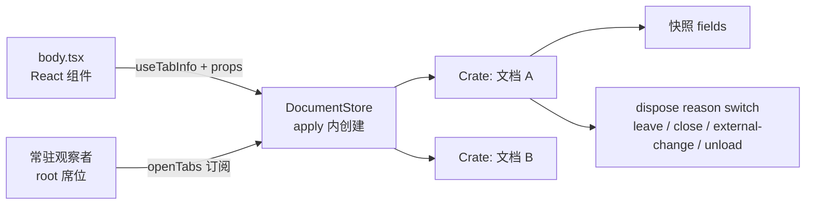

# Active Markdown 状态统一：合成设计

> 状态：设计定稿（2026-11-25），待实施。两份并行草图见 `/tmp/am-store-arena/candidate-a.md`
> 与 `candidate-b.md`（临时目录），交叉评判见同目录 `judge-brief.md` 的产出。本文是合成结论，
> 取代 [STATE-STORE-TECH.md](STATE-STORE-TECH.md) 第 3 至第 6 节的草图级描述。

## 0. 目标（一句话）

用户切走一篇正在读的文档（切页签、切会话、收起侧栏、退出全屏）再回来时，阅读位置、
译文进度、未保存的编辑都在；只有主动关闭页签或文件被外部修改时才让路。

## 1. 实测基线（本机 Web profile，2026-11-25）

这些不是推断，是在 `dsh --profile web` 起的 GUI 里量到的。

| 事实 | 证据 |
|---|---|
| 切页签会把文档 body 卸载 | 切页签后 `document.querySelector('[data-active-markdown]')` 为 `null` |
| 切回来阅读位置归零 | 切走前 `[data-textpreview-body].scrollTop = 700`，切回后为 `0` |
| body 的 `slots.register` `inject` 工厂只收到一个字符串参数 | 运行时探针：`arity: 1`, `argTypes: ['string']` |
| 但 body **确实**收到 `useTabInfo` 作为 props | 运行时探针：`typeof props.useTabInfo === 'function'`，与 `useSession` / `useResource` 并列 |
| 宿主的 `scrollportRef(null)` 会回落到宿主自己的 body 元素并重写 `scrollTop` | `TextPreview.tsx:122-125` |
| 宿主还会在内容 ready 时 `scrollTop = Math.max(scrollTop, stored)` | `TextPreview.tsx:148` |
| 插件无法为 `text` 页签类型注册关闭钩子 | `service.ts:318` 对同 kind 二次注册直接 `throw` |
| 页签记录消失会 abort `tab.signal` | `tab-domain.ts:57-58`、`:92-97` |
| 切会话不 abort `tab.signal`，只把视图隐藏（`active=false`） | `RightbarRoot.tsx:21-24`、`session-views.ts:67` |
| 页签库 `openTabs` 是公开订阅源，含 `{sessionId, tabId, kind, contentId}` | `service.ts:303`、`tab-inventory.ts:19-20` |

**结论：`tab.signal` 可靠地区分“关闭”与“切走”，但它只在 body 挂载期间有人监听。**
切走时 body 卸载，关闭就没人听见。这是本设计必须解决的核心问题。

## 2. 结构：每文档一个 crate



**单位是文档，不是 store。** 每个文档一个 crate，crate 拥有该文档的全部状态与三条生命
周期规则。`DocumentStore` 只做三件事：按键找 crate、跨文档的扇出（关闭清理、草稿播种）、
接收常驻观察者的信号。

选择 crate 而不是“一个大 store 带十几个按 key 的方法”，理由来自交叉评判的核心发现：
规则是**对字段集合的整体判断**，不是对单个字段的判断。散在大对象上，每条规则要在调用方
重新拼一遍，某个未来调用者可以只做一半。一个 crate 一个 `dispose(reason)` 的 switch，
规则只存在一处。

## 3. 身份：三层键

```ts
export type DocumentRef = {
  readonly session: string      // 文件所属会话，授权读、翻译、保存、编辑
  readonly path: string         // 规范绝对路径
  readonly compose: string      // 输入框所在会话，批注草稿归它
}
```

三个身份必须共存，实测与代码都证明了：

- `session` 管所有文件操作（`body.tsx` 的 `loadDocument`、`bridge.translate/save`、
  `editCommand.check`）；
- `compose` 管批注草稿，因为草稿最终变成输入框里的附件（`attachment.ts:218` 显式拒绝
  两者不等的情况）；
- `path` 是文档本身。

**crate 按 `session + path` 键控**（文件身份），`compose` 是 crate 内的一个维度
（`notes.byCompose`）。两个输入框会话看同一个文件时共用一个 crate，不会重复读 2MB
正文、重复解析、重复翻译。

**翻译运行（run）按 `path` 键控**，不按 crate。同一文件被两个 composer 打开时，翻译
只跑一次，谁挂载谁收集结果。这是交叉评判嫁接的第一点：run 是独立对象，有单一 owner，
避免两个 crate 抢一个 `AbortController`。

## 4. 三条规则，一个 switch

```ts
export type Disposal =
  | 'leave'             // 什么都没发生：主体不跑 switch，crate 原样保留
  | 'close'             // 页签记录消失：终止翻译、清批注内存+磁盘、丢编辑草稿
  | 'external-change'   // 文件被外部改写：同上，但保留阅读位置
  | 'unload'            // 插件卸载：只清内存，不动磁盘
```

`close` 与 `external-change` 的差别只有一个字段：阅读位置保留与否。其余字段处置相同，
所以它们共享一个 `drop()` 实现，`close` 额外清 `reading`。

`unload` 是交叉评判指出的坑：`tab-domain.ts:57-58` 明写页签消失**和插件卸载**都会
abort。今天把每次 abort 当 close，插件一重载就会清空所有磁盘批注。这是真实的数据丢失，
必须区分。

## 5. 关闭怎么被观测：常驻观察者

这是本设计最重要的一个决定，也是交叉评判推翻了两个候选的共同结论。

**在 `apply` 作用域里注册一个常驻观察者，它订阅 `ctx.sidebarRight.openTabs`，不依赖
任何 body 挂载。**

```ts
// main.tsx 的 apply 内
ctx.inject(['sidebarRight'], (scoped) => {
  const store = createDocumentStore({ host, ... })
  const owned = new Map<string, { ref: DocumentRef, signal: AbortSignal }>()
  // body 挂载时把 (ref, tab.signal) 交给 store；观察者据此判断
  scoped.effect(() => {
    const sync = (): void => {
      const open = scoped.sidebarRight.openTabs.getSnapshot()
      for (const [key, entry] of owned) {
        if (entry.signal.aborted) { store.dispose(key, 'leave-abort'); owned.delete(key); continue }
        if (!open.some(tab => tab.contentId === addressOf(entry.ref))) store.dispose(key, 'close')
      }
    }
    const unsubscribe = scoped.sidebarRight.openTabs.subscribe(sync)
    return () => { unsubscribe(); store.disposeAll('unload') }
  }, 'active-markdown document observer')
})
```

为什么常驻观察者是必需的：body 卸载后没有任何监听者，而 `openTabs` 是宿主的公开
订阅源（`ui-sidebar-terminal` 已经用它管窗口）。观察者在 `apply` 层，`apply` 的寿命
覆盖插件整个存活期，所以关闭发生在 body 未挂载时也能被看到。

为什么不能只靠 body 内的 `tab.signal`：切走时 body 卸载，监听器随之消失。候选 B 试图用
“acquire 时重检 `signal.aborted`”补，但隐藏页签被关闭后**不会有人再 acquire**，那条路径
只在用户重开同一文件时才生效。

观察者需要知道 body 挂载过的所有 ref 及其 signal，所以 body 挂载时登记、卸载时撤销登记。
登记是 `apply` 层的一个 Map，不是全局单例。

**同时必须区分 `abort` 的来源。** `plugin unload` 也会 abort 每个 signal。区分办法：
在观察者自身的 `effect` 清理里先把 `disposed` 置真，然后才让 signal abort 回调运行；
观察者判断 `disposed` 就不再当作 close。这条顺序性保证比任何时间窗口都可靠。

## 6. 状态：一个快照，四块

```ts
export interface DocumentSnapshot {
  readonly notes: AnnotationSnapshot            // 已有，原样搬入
  readonly run: TranslationState                // 五态机
  readonly edit: EditState                      // 现有 reducer 输出
  readonly view: {
    readonly choice: 'source' | 'translated'
    readonly reading: number                    // 源码视图滚动位置
    readonly translated: number                 // 译文视图滚动位置
    readonly collapsed: readonly string[]       // 目录折叠
    readonly updateCursor: number               // “更新 N 处”游标
  }
}
```

**阅读位置按视图分开记。** 原文和译文的长度不同，用一个数字在两者间切换时会跳位。这是
合成时的取舍，两个候选都只记了一个。

**按文档而不是按页签记位置**（已与用户确认）。两个页签看同一文件共享位置，可接受。

## 7. 滚动：body 拥有元素，crate 拥有位置

实测到的两个陷阱：

1. `bindScrollport(null)` 会让宿主把滚动容器退回它自己的 body 元素，并把 `scrollTop`
   重写成它记的值；
2. 宿主在内容 ready 时还会用 `Math.max(scrollTop, stored)` 改写一次。

**做法**：body 自己的 `.am-root` 是滚动容器（`overflow: auto`），绑定回调只对非空节点
转发给宿主的 `scrollportRef`，永不传 `null`。绑定顺序必须是**先 `scrollportRef(node)`，
后设 `scrollTop`**，否则宿主会覆盖恢复值（这是交叉评判抓到的候选 A 的顺序错误）。

恢复时机在内容 ready 之后（此时高度已确定），恢复一次。之后的滚动事件写入 crate。

**为什么不用内容相对锚点**：候选 A 提出按块和行记锚点，重排后能落到同一个段落。但它依赖
块模型，遇到 Mermaid / 表格这类高度不定的组件块会偏一个块。按像素记更简单，且用户切走
再回来时布局宽度基本不变（侧栏宽度是持久的），像素足够。作为已知取舍记下。

## 8. 批注怎么收编

`AnnotationStore` 今天的 10 个方法（`subscribe` / `getSnapshot` / `load` / `withLock` /
`write` / `attach` / `regenerate` / `detach` / `commit` / `clear`）**保留名字与语义**，
搬进 crate 的 `notes`。`Entry` 的 `snapshot` / `generation` / `loadPromise` /
`listeners` 全部保留，`key` 从方法参数变成 crate 的 `compose`。

外部消费者的真实依赖（交叉评判核实，比两份候选都更准）：

- `attachment.ts` 用了 `store.withLock`、`store.getSnapshot(key)`（`:222`、`:320`）、
  `store.attach(key, pending)`（`:290`）；
- `committer.tsx` 用整个 store，且它的测试 `committer.test.ts` **不构造 store**，只测
  纯函数；
- `attachment.test.ts` 构造 `createAnnotationStore` 并读 `getSnapshot`。

所以收编时：`AttachmentDeps.store` 的类型改为 crate 的 `notes` 接口，`getSnapshot` 必须
在接口里（候选 A 漏了它，会直接编译不过）。`committer.tsx` 改为接收 `DocumentStore`
和 `compose`，内部用 `documents.notesFor(compose, path)` 取到该 crate 的 notes。

## 9. 不做的部分

沿用用户确认的易失定位：不落盘任何 store 状态，不做关闭前确认弹窗，不做批注归档，
不做“切走暂停翻译”。这四项见 [BACKLOG.md](BACKLOG.md)。

## 10. 迁移路径

每步一个 worktree / 分支，自测全绿后合 `main`。

1. **crate 骨架 + 批注收编**：新建 `client/src/store/`，把 `annotate/store.ts` 搬成
   `store/kernel/annotations.ts`，`DocumentStore` 外壳只做查找与扇出。
   验收：`pnpm test` 全绿（含 `attachment.test.ts`），Web 实测批注 / 加入对话 / 更新标记
   无回归。
2. **阅读位置**：绑定 `scrollportRef`、监听 scroll 事件、ready 后恢复一次。
   验收：实测“读到一半切页签/切会话再回来，位置不丢”。
3. **翻译外提**：`translation` 的 `useState` / `useRef` 换成 crate 的 `run`，
   `stopRun` 从卸载路径摘掉。
   验收：翻译中切走 30 秒再切回，进度连续且不重发请求。
4. **编辑草稿**：`edit` reducer 输出进 crate；外部变更时丢弃。
   验收：切走再切回草稿完整；外部改文件后编辑器关闭、草稿丢弃。
5. **视图偏好**：`choice` / `collapsed` / `updateCursor` 进 crate。
6. **常驻观察者**：接 `openTabs` 与 `tab.signal`，实现 close 与 unload 的区分。
   验收：关闭页签后重开，全部状态为初始值且磁盘批注已清；插件重载不清磁盘批注。

第 6 步依赖 1 到 5 的 crate 已经存在，所以放最后。

## 11. 验收总清单

- 切页签、切会话、收起侧栏、全屏进出后：阅读位置、视图模式、目录折叠、更新游标保留。
- 翻译中切走再切回：进度连续，不重发请求；切走期间完成则回来直接显示译文。
- 编辑中切走再切回：草稿完整，光标行保留。
- 文件被外部修改：批注、翻译、编辑草稿清空，阅读位置保留，有告知。
- 关闭页签后重开同一文件：全部状态为初始值，磁盘批注已清。
- 插件重载（不关页签）：磁盘批注不被清空。
- `pnpm typecheck` / `pnpm test` / `pnpm build` 全绿。

## 12. 吞吐检查点

- **阻塞性前置步骤**：crate 骨架与 `store/` 目录结构必须先落地，否则后面五步都会在
  `body.tsx` 里互相打架。第 1 步是唯一的阻塞项。
- **可并行的工作流**：第 2、3、4、5 步改的是 `body.tsx` 里互不相交的状态块，但**同处一个
  文件**，所以不能真并行写。它们串行，每步独立可验证。
- **共享可变状态**：`main.tsx` 的 `apply` 是唯一安装点，串行修改。`body.tsx` 是唯一的
  大文件写入点，串行。
- **最小安全拆分**：一个 worker。理由：六步全在 `packages/active-markdown/client/src/`
  的同两个文件里，并行只会制造冲突，收益为零。
