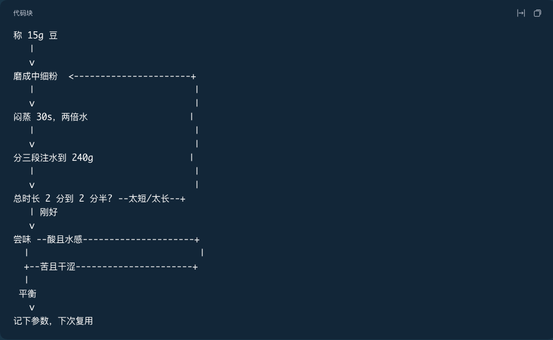
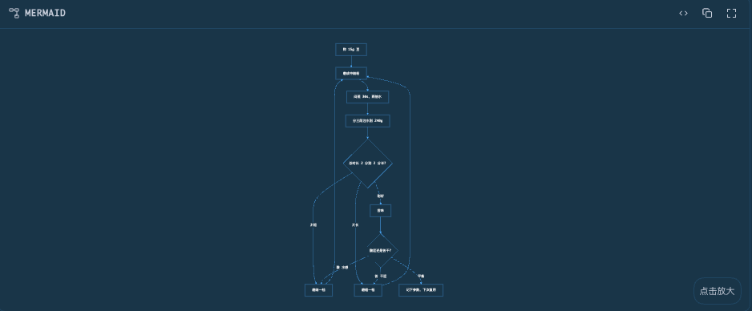
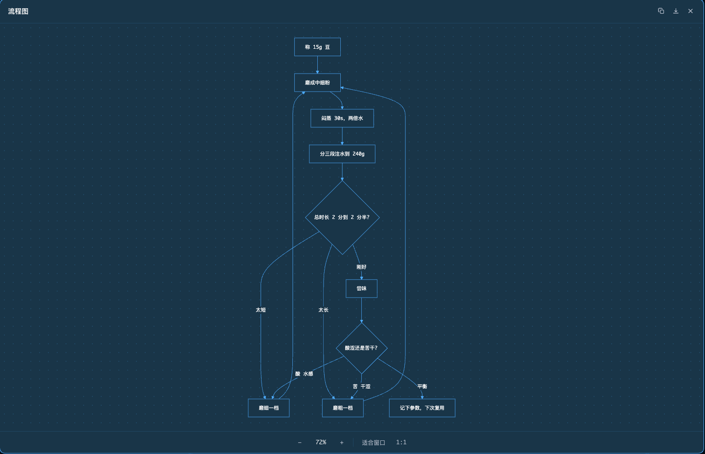

# 友好表达 使用手册

> 状态：v0.1。npm 包 `@westwall/dsh-friendly-expression`。

Agent 的回复常常信息堆砌、结构松散；需要解释流程或关系时，又容易甩出一张用方框和箭头拼的 ASCII 图。友好表达把这件事拆成两层：用一段可编辑的「受控表达」约束「怎么说」，用 Mermaid 渲染解决「怎么呈现」。

默认约束的取向是「说人话」：先给结论、少客套、只讲相关信息；需要图示时不画 ASCII 方框箭头，直接用 Mermaid。这里的「受控表达」指一段你可以替换的约束文本，不是 ASD-STE100 之类的标准或认证。

## 快速开始

```sh
dsh plugin --profile <profile> add @westwall/dsh-friendly-expression
```

1. 安装后重载页面，或重启宿主。
2. 打开「设置」→「友好表达」，按需修改表达提示词。
3. 新开一个会话。提示词只对新会话生效，已存在的会话不会追溯注入。

本地开发用 `link:` 安装：

```sh
dsh plugin --profile <profile> add link:/绝对路径/packages/friendly-expression
```

## 截图

从 ASCII 草图到可缩放的图：








## 配置

入口在「设置」→「友好表达」，不在插件详情页。

| 项 | 说明 |
|---|---|
| 表达提示词 | 最长 800 字符，默认是一段推荐文案；可修改，可恢复默认 |

- 设置页的 800 字符计数只算可编辑正文。注册时宿主会在正文前加一行固定的英文引导语 `When talking with the user, follow these principles:`；它不出现在设置页，不占这 800 字符，也不随「恢复默认」变化。正文为空时不注册这一段。
- 保存后只影响新会话。已存在会话使用创建时的提示词快照，重启或恢复后也不变，这样 system prompt 的前缀保持稳定，不会破坏模型的前缀缓存。
- 恢复默认会移除用户覆盖、回落到推荐文案，同样只影响新会话。
- 保存空字符串表示新会话不再注入表达提示词。

## 默认文案怎么来的

默认文案把格赖斯合作原则改写成可执行的动作，不抄原文：

| 合作原则 | 默认约束里的动作 |
|---|---|
| 数量：信息充分 | 先给结论，再给必要依据；不复述已知内容 |
| 质量：真实 | 不确定的地方明确标注，不编造 |
| 关联：相关 | 紧扣问题，只讲相关信息 |
| 方式：清晰 | 长内容分点、按重要性排序；对比用表格；关系用 Mermaid |

这几条都能在默认提示词里找到对应句子。修改提示词时，不需要保留这套结构；它只是推荐起点。

## 支持的图表

Mermaid 11.15.0 内置的图表类型都能渲染：流程图、时序图、状态图、ER 图、类图、甘特图、饼图、思维导图、时间线、用户旅程、Git 图、四象限图。ZenUML 等外部插件不在包内。

## 日常使用

1. 在「设置」→「友好表达」里按需修改表达提示词。
2. 新开会话后，Agent 按提示词组织回复；需要画图时默认用 Mermaid 表达。
3. Mermaid 代码块在消息里渲染成图。流式生成时先显示源码，落定后再显示图；预期结果是图卡片出现在原代码块的位置。
4. 图卡片右上角可以切换源码、复制源码、放大查看。
5. 点击图打开浮窗。浮窗支持滚轮缩放、拖拽平移、适合窗口、1:1、复制源码和下载 SVG。
6. 渲染失败时显示错误块，可用「查看源码」切换源码。点「复制错误给 Agent」，会复制完整 parser 错误（界面只显示摘要），粘贴回会话即可让模型重新生成。
7. 插件启用且提示词非空时，会话头部会出现一个小图标，悬停或键盘聚焦显示「友好表达已开启」。

## 限制

- 只在 Web/桌面渲染面注入提示词。CLI / headless profile 不注入，因为终端没有渲染面，Mermaid 源码会比 ASCII 更难读。
- 子代理不注入。友好表达面向用户和 Agent 的对话，子代理的输出是给父代理看的。
- 只处理 assistant 消息里的 Mermaid 围栏。用户消息、工具卡片、详情页不在范围内。
- 徽章是插件级状态：插件启用且提示词非空就显示。安装前已存在的旧会话即使显示徽章，也可能没有提示词快照；需要新开会话才会真正生效。
- 定时任务、工作流等非交互会话也会按普通新会话捕获快照；记录很小，长期运行可按下面的方式清理。

## 故障排查

| 现象 | 先查 |
|---|---|
| 旧会话里没有出现提示词效果 | 提示词只对新会话生效；先新开一个会话 |
| 回复里出现 Mermaid 源码块 | 当前 profile 是否走 Web/桌面渲染面；插件是否启用；代码块是否在 assistant 消息里 |
| 图渲染失败 | 看错误块里的摘要；点「复制错误给 Agent」复制完整错误，让模型重生成；也可以切换源码手动检查 |
| 会话头部没有小图标 | 插件是否启用；表达提示词是否为空 |

## 卸载与清理

```sh
dsh plugin --profile <profile> remove @westwall/dsh-friendly-expression
```

卸载后提示词不再注入，Mermaid 代码块恢复为普通代码块。

每个会话的提示词快照保存在默认 JSON 存储的 `~/.dsh/storages/friendly_expression/`（如果 profile 使用其他存储后端，路径由该后端决定）。快照保存注册用的完整 section 文本（含固定英文引导语）和捕获时间，不含凭据。卸载不会自动删除；需要清理时手动删除该目录。删除后，旧会话在下次恢复时不再注入提示词。

## 相关链接

- 作者主页 [github.com/westwall586](https://github.com/westwall586)
- 插件仓库 [dsh-westwall-plugins](https://github.com/westwall586/dsh-westwall-plugins)
- 更多插件 [插件库的插件表](https://github.com/westwall586/dsh-westwall-plugins#插件)

### 更多插件

同系列插件见插件库。想固定某个提交安装：

```sh
dsh plugin --profile <profile> add \
  "git+https://github.com/westwall586/dsh-westwall-plugins.git#<commit>&path:/packages/<插件目录>"
```

`<commit>` 是 40 位提交 SHA，`<插件目录>` 是包目录名。

### 维护者文档

- [设计文档](docs/DESIGN.md)：定位、注入机制、会话快照、默认提示词、验收标准
- [迭代路线](docs/ROADMAP.md)：v0 到 skill 的拆分与不采用的方向

### 许可

插件代码 Apache-2.0，见仓库根 [LICENSE](../../LICENSE)。内置的 Mermaid 11.15.0 使用 MIT 许可，版权声明随 `client.js` 一起分发。
